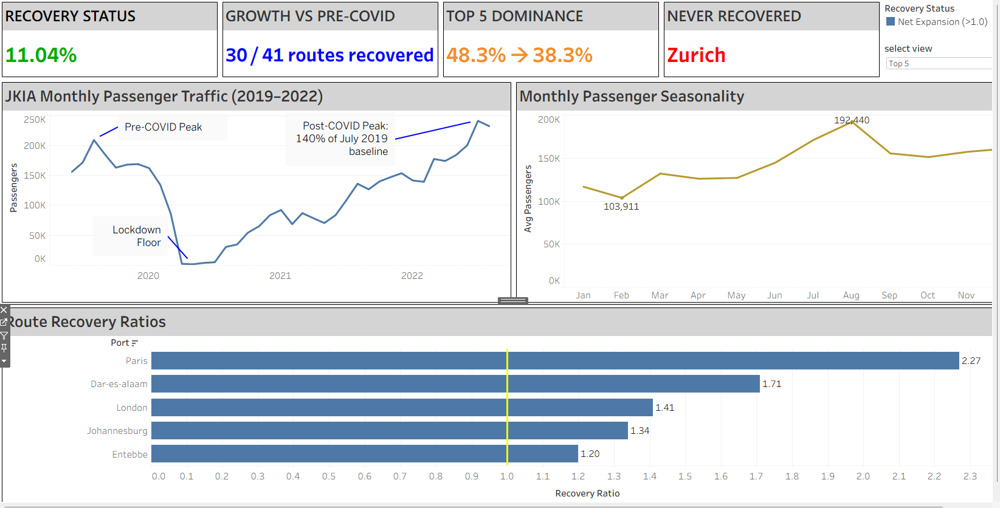
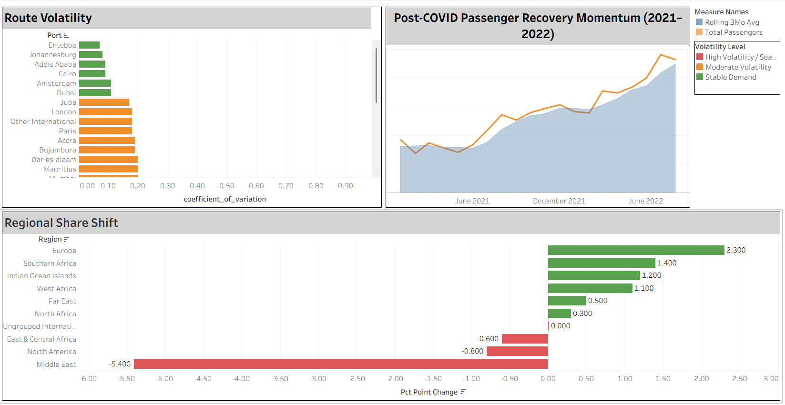

# ✈️ JKIA Aviation Recovery Analysis: Beyond the Pandemic

An end-to-end BigQuery analysis of how Jomo Kenyatta International Airport — East Africa's largest aviation hub — recovered from COVID-19, and how its route network changed shape in the process.

**[→ View the live dashboard on Tableau Public](https://public.tableau.com/views/TrafficAnalytics_17894144407200/JKIAPassengerRecoveryRoutePerformanceExecutiveOverview?:language=en-US&publish=yes&:origin=viz_share_link)**

---

## Overview

Most "COVID recovery" analyses stop at one question: did traffic come back? This project goes further. Using monthly passenger data across 41 international routes (June 2019–August 2022), it investigates *which* routes came back, *how fast*, and *what changed permanently* about the airport's network in the process.

The short version: **JKIA didn't just recover. It regionalized and diversified.**

---

## Key Findings

| Metric | Result | Analytical Context |
|---|---|---|
| **Peak Traffic Recovery** | **140%** | July 2022 passenger count vs. July 2019 pre-COVID peak |
| **Sustained Annual Recovery** | **+11%** | 2022 full-year average vs. 2019 full-year average |
| **Route Recovery Rate** | **30 of 41** | Individual routes meeting or exceeding 2019 baseline levels |
| **Top-5 Route Dominance** | **48.3% → 38.3%** | Traffic diversified away from extreme reliance on top 5 hubs |
| **Regional Share Shift** | Europe **+2.3pp**, Middle East **−5.4pp** | Structural rebalancing of connecting network |
| **Permanent Atrophy** | **Zurich (0.00)** | Routes that failed to return post-pandemic |

---

## 🚀 Top Movers (Major Hub Recovery Ratios)

*Note: Low-volume routes (<5,000 pre-COVID monthly average) and regional aggregate buckets (e.g., "Other Indian Ocean Islands") were filtered out using baseline logic to avoid percentage distortions.*

| Route | Pre-COVID Baseline Avg | Recent Avg (2022) | Recovery Ratio | Recovery Speed | Verdict |
|:---|:---:|:---:|:---:|:---:|:---|
| **Paris** | ~6,030 | ~13,700 | **2.27x** | 15 months | Winner |
| **Dar-es-Salaam** | ~6,000 | ~10,260 | **1.71x** | 20 months | Winner |
| **London** | ~9,900 | ~13,960 | **1.41x** | 18 months | Winner |
| **Johannesburg** | ~7,900 | ~10,580 | **1.34x** | 22 months | Winner |
| **Entebbe** | ~12,400 | ~14,880 | **1.20x** | 14 months | Winner |
| **Bangkok** | ~1,700 | ~470 | **0.28x** | — | Laggard |
| **Zurich** | ~2,800 | 0 | **0.00x** | — | Laggard |

---

## 💡 Key Insights & Strategic Recommendations

Based on the BigQuery analysis and Tableau visualizations, the post-pandemic recovery at JKIA highlights three critical structural shifts:

### 1. The Regional Resilience Effect (Intra-African Surge)
* **Insight:** While long-haul routes faced international travel restrictions and friction, high-certainty regional connections like **Dar es Salaam (1.71x)**, **Johannesburg (1.34x)**, and **Entebbe (1.20x)** expanded rapidly, proving that JKIA's core strength lies in its role as East Africa's primary gateway.
* **Recommendation for JKIA / Policymakers:** Double down on bilateral aviation agreements and regional open-skies policies within Africa. Streamlining regional transit will cement JKIA’s status as an indispensable continental hub.

### 2. European Hub Consolidation vs. Middle Eastern Shifts
* **Insight:** Major European trunk routes like **Paris (2.27x)** and **London (1.41x)** strongly outperformed pre-pandemic volumes, whereas Middle Eastern share dropped by **-5.4pp**, indicating a shift in how passengers connect to Western markets.
* **Recommendation for Airlines:** Prioritize high-frequency, direct long-haul capacity to core European economic hubs rather than over-relying on secondary connecting points.

### 3. Permanent Route Atrophy & Capital Reallocation
* **Insight:** Structural laggards like **Zurich (0.0% recovery)** show that airlines permanently pruned unprofitable or redundant long-haul legs post-COVID.
* **Recommendation for Airport Operators:** Reallocate gate slots, scheduling priority, and marketing incentives away from dormant long-haul routes toward expanding regional carriers and high-growth African routes.

---

## 🛠️ Data Engineering & Audit Quality

To ensure the analysis was grounded in accurate, trustworthy numbers, a complete data audit was performed during ETL:

* **Table Scaling:** The raw grid CSV (~1,600 rows across 41 destinations and 39 months) was transformed into a tidy long table using BigQuery SQL (`UNPIVOT`), yielding ~1,600 clean destination records.
* **Checksum Validation:** Summing destination-level totals against regional aggregate reporting revealed a discrepancy of **<1%**, confirming high source data integrity.
* **Total Traffic Validation:** Summing regional totals against "Total International" figures yielded a discrepancy of **<0.5%**.
* **Anomaly Handling:** April–May 2020 zero-passenger values were preserved as structural zeroes (COVID shutdown), while complete route drop-offs (e.g., Zurich) were flagged as structural laggards rather than dropped as missing data.

---

## Data Source

**JKIA Passengers by Destination** — Maven Analytics' Kenya dataset series, tracking passenger movement from Jomo Kenyatta International Airport across destinations and reporting periods.

---

## Tech Stack

- **Warehouse:** Google BigQuery
- **Transformation:** GoogleSQL — `UNPIVOT`, window functions, CTEs
- **Visualization:** Tableau
- **Version control:** GitHub

---

## SQL Workflow

A 15-step pipeline, in three phases:

1. **Data engineering & auditing (steps 1–6)** — unpivoted raw grid-format data into a long table, then checksum-validated destination totals against regional reporting to catch transformation errors before any analysis ran on top of them.
2. **Historical benchmarking (steps 7–10)** — calculated recovery ratios against the July 2019 baseline and mapped seasonal traffic cycles.
3. **Advanced insights (steps 11–15)** — regional share-shift analysis, route concentration (Gini-style dominance scoring), and month-over-month momentum classification.

---

## Dashboard

*Monthly passenger traffic, recovery status, and route-level recovery ratios.*

*Route volatility, post-COVID recovery momentum, and regional share shift.*

---

## What I'd Extend Next

- Bring in airline-level data to see whether regionalization is a network effect or a handful of carriers repositioning.
- Add cargo traffic as a comparison — passenger and freight recovery often diverge.
- Automate the monthly refresh pipeline so the Tableau dashboard updates via API instead of manual pulls.

---

**Contact:** [Reach me through my portfolio](https://waweru123.github.io/#contact) · [LinkedIn](http://www.linkedin.com/in/waweru-c48b838220)
